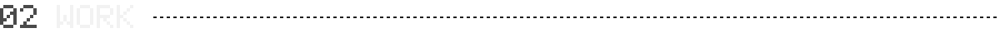
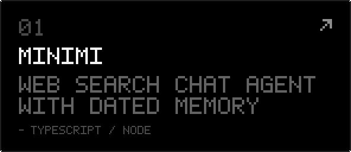
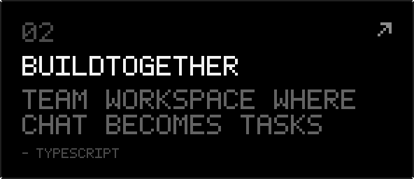
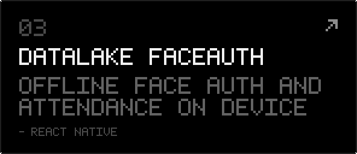
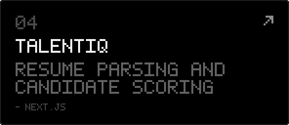
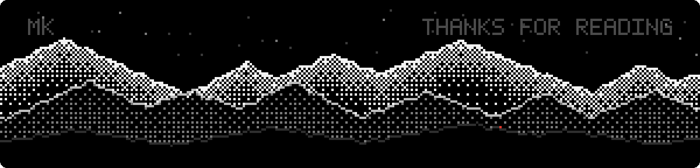

 

I design interfaces and then build them myself, so nothing gets lost between the mockup and the product. Most days that means Figma in one window and React in the other.

Right now I'm working on **[minimi](https://github.com/mano45sudo-lgtm/minimi-chat-agent)**, a chat assistant that searches the web and remembers what you talked about, and when.

 

 

 

 

[GitHub](https://github.com/mano45sudo-lgtm) &nbsp;·&nbsp; [LinkedIn](https://www.linkedin.com/in/m-mano-karthik-a82b51376) &nbsp;·&nbsp; [Email](mailto:mano45sudo@gmail.com)

 

